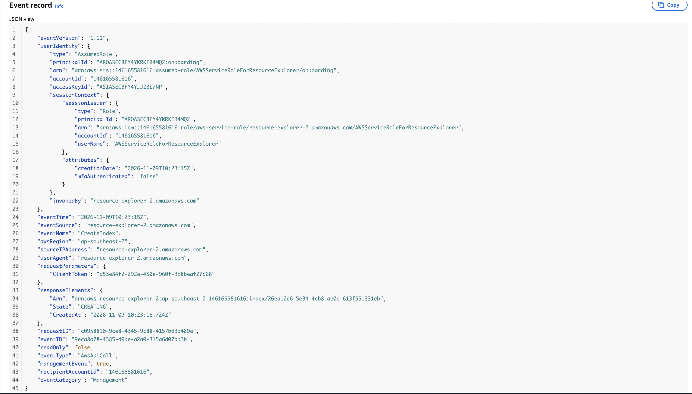
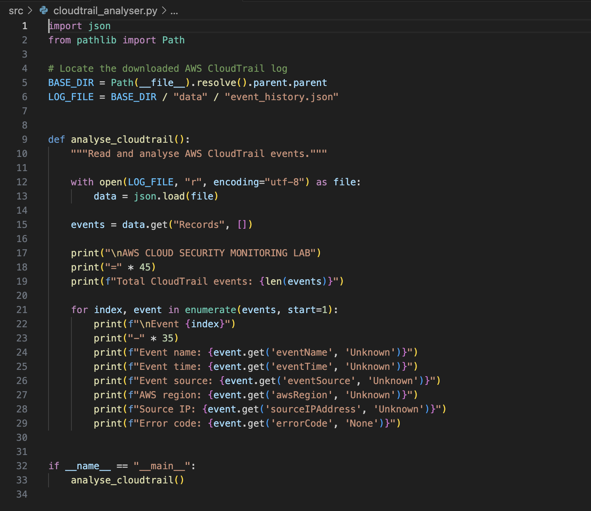
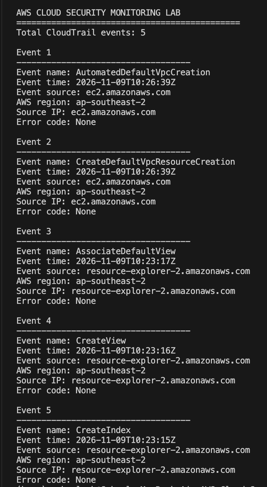
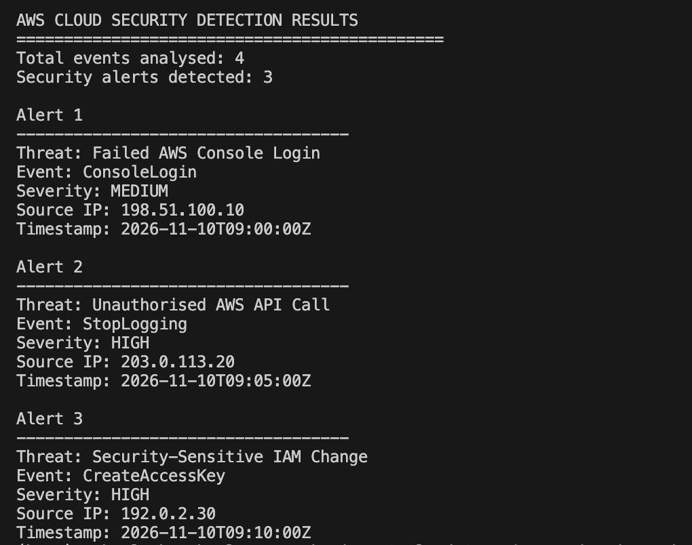
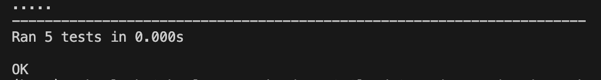
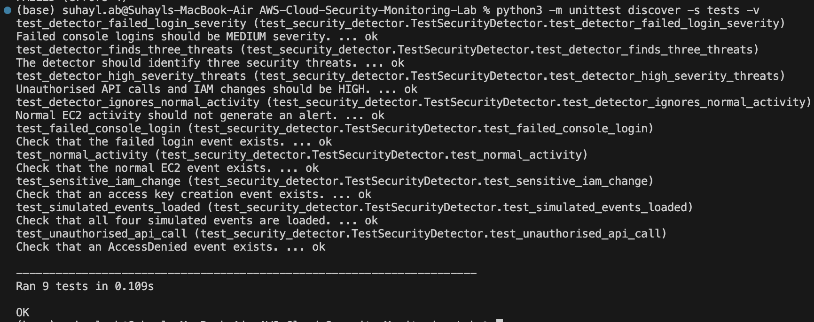

# AWS Cloud Security Monitoring Lab
A Python-based cloud security monitoring project that analyses AWS CloudTrail events, identifies potentially suspicious activity and generates structured security alerts.

This project demonstrates practical skills in AWS cloud security, security log analysis, threat detection, Python automation and automated testing.

## Project Overview
AWS CloudTrail records API activity and management events across AWS environments. Analysing these events can help security analysts identify unusual activity, investigate security incidents and monitor changes to cloud resources.

This lab combines real AWS CloudTrail event exports with simulated security events to demonstrate how a basic security monitoring and detection workflow operates.

**Project objectives:**
- Retrieve and analyse AWS CloudTrail management events.
- Identify failed AWS Console logins.
- Detect unauthorised API calls and sensitive IAM changes.
- Generate security alerts with severity classifications.
- Export structured security findings to CSV.
- Validate detection behaviour through automated tests.

## Technologies Used
- **AWS CloudTrail** — Cloud activity and audit logging
- **Python 3** — Event analysis and threat detection
- **JSON** — CloudTrail event data
- **CSV** — Security alert reporting
- **unittest** — Automated testing
- **VS Code** — Development environment

## Project Structure

```text
AWS-Cloud-Security-Monitoring-Lab/
├── alerts/
│   └── aws_security_alerts.csv
├── data/
│   ├── event_history.json          # Private AWS export (not published)
│   └── simulated_security_events.json
├── reports/
├── screenshots/
├── src/
│   ├── cloudtrail_analyser.py
│   ├── security_detector.py
│   └── alert_generator.py
├── tests/
│   └── test_security_detector.py
├── .gitignore
└── README.md
```

The real CloudTrail export is excluded from Git using `.gitignore`. Simulated security events are provided for reproducible testing.

## How the Lab Works
1. AWS CloudTrail records management events from the AWS account.
2. CloudTrail event history is exported as JSON for local analysis.
3. The Python analyser extracts event details, including event names, timestamps, regions and source IP addresses.
4. The security detector evaluates simulated events against predefined detection rules.
5. Matching events are classified by severity and exported to a CSV report.
6. Automated tests verify the expected detection outcomes.

**Note:** This is a local, rule-based analysis lab, not a continuous or real-time AWS monitoring service.

## Security Detection Rules

| Detection rule | Example event | Severity |
|---|---|---|
| Failed AWS Console Login | `ConsoleLogin` with `Failure` | MEDIUM |
| Unauthorised AWS API Call | `AccessDenied` or `UnauthorizedOperation` | HIGH |
| Security-Sensitive IAM Change | Successful `CreateAccessKey` | HIGH |

Additional sensitive IAM actions include `AttachUserPolicy`, `PutUserPolicy`, `CreateUser` and `UpdateAssumeRolePolicy`.

Severity classifications are illustrative lab rules rather than production risk assessments.

## Detection Results
Four simulated AWS events were analysed:

| Event | Detection result | Severity |
|---|---|---|
| `ConsoleLogin` (failed) | Failed AWS Console Login | MEDIUM |
| `StopLogging` (`AccessDenied`) | Unauthorised AWS API Call | HIGH |
| `CreateAccessKey` | Security-Sensitive IAM Change | HIGH |
| `DescribeInstances` | Normal activity — no alert | — |

**Results:** 4 events analysed, 3 alerts generated and 1 normal event ignored.

The detector records the event name, threat description, severity, source IP address and timestamp.

## Running the Project

### Requirements
- Python 3
- No external Python packages required

Clone the repository and navigate to the project directory.

To analyse the included simulated security events:

```bash
python3 src/security_detector.py
```

To generate the CSV security alert report:

```bash
python3 src/alert_generator.py
```

The report is saved to:

```text
alerts/aws_security_alerts.csv
```

To analyse a real AWS CloudTrail export, place your own exported `event_history.json` inside the `data/` folder and run:

```bash
python3 src/cloudtrail_analyser.py
```

Do not publish actual AWS logs without reviewing and sanitising their contents.

## Automated Testing
The project includes nine automated tests covering simulated event validation and security detection behaviour.

Run the test suite from the project root:

```bash
python3 -m unittest discover -s tests -v
```

Verified result:

```text
Ran 9 tests

OK
```

The tests confirm that the detector identifies the three expected threats, assigns the expected severity levels and excludes the normal EC2 activity.

## Project Screenshots
The following screenshots demonstrate the AWS CloudTrail analysis, security threat detection, alert generation and automated testing.

### 1. AWS CloudTrail Event



*AWS CloudTrail event details showing a recorded AWS API activity.*

### 2. CloudTrail Analyser Code



*Python script used to read and analyse exported AWS CloudTrail events.*

### 3. CloudTrail Event Analysis



*Successful analysis of five real AWS CloudTrail management events.*

### 4. Security Threat Detection



*Three security alerts detected from four simulated CloudTrail events.*

### 5. CSV Security Alert Report


*Generated CSV report containing security threats, severity classifications and event details.*

### 6. Initial Automated Testing



*Five initial tests verifying the simulated security event dataset.*

### 7. Final Automated Testing



*All nine automated tests passed, including tests of the security detection logic.*


## Security and Privacy
- Real AWS CloudTrail exports are excluded from version control.
- Simulated events use documentation-only IP address ranges.
- No AWS credentials or access keys are required to run the local scripts.
- The detection rules operate on downloaded JSON files rather than directly accessing AWS APIs.

## Limitations and Future Improvements
The current implementation uses static, rule-based detection against locally stored CloudTrail events.

Potential improvements include:

- Automated CloudTrail event ingestion
- CloudWatch and EventBridge integration
- SNS email notifications
- A security monitoring dashboard
- Detection of repeated failed login attempts
- More comprehensive IAM activity analysis
- Expanded test coverage using additional simulated events

## Skills Demonstrated
AWS CloudTrail · Cloud Security · Python · JSON Log Analysis · Threat Detection · Security Monitoring · Incident Investigation Fundamentals · CSV Reporting · Automated Testing

## Disclaimer
This project was developed for educational and cybersecurity portfolio purposes. All simulated security incidents are fictional and were not executed against a live AWS environment. 